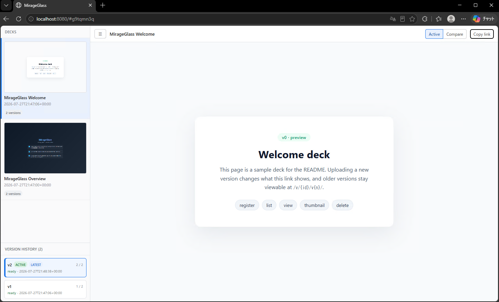

# MirageGlass

MirageGlass is a self-hosted viewer and version manager for HTML presentation decks. Each upload is a ZIP archive with a single `index.html` at its root. A deck keeps one stable viewer URL while new uploads build its version history.



## What it provides

- Registration and version uploads through a token-protected API
- Stable active-viewer links and version-specific viewer links
- Downloadable deck archives and file manifests
- Automatic thumbnails, with registration remaining available if capture fails
- A browser dashboard for browsing versions and comparing two versions side by side
- Optional multi-screen decks (a `screens.json` manifest groups several screens under one deck) with a per-screen or deck-wide version timeline
- Idempotency keys for safe registration and upload retries
- A hierarchical group library with collapsible navigation, search, card/list views, range selection, and atomic bulk moves
- Server-owned favorites, recent visits, and version notes shared by the console and API clients

## Quick start

```bash
pip install -r requirements.txt
python -m playwright install chromium
cp .env.example .env
# Set MIRAGEGLASS_TOKEN in .env.
uvicorn server.main:app --port 8100
```

MirageGlass creates `storage/` on first start and applies database migrations automatically through `auto_migration: true`.

`server/config.py` loads `.env` with `load_dotenv()`. Variables already exported in the environment take precedence because dotenv loading uses `override=False`.

## Looking up the usage guide

```text
GET /api/v1/help
```

This unauthenticated endpoint returns the available endpoints, recommended workflow, and common gotchas as JSON. Use `/docs` for the OpenAPI schema and `/api/v1/help` for task-oriented instructions.

## Registering a deck

Multipart fields **must be sent as UTF-8**. For automation, use `requests` so behavior does not depend on the console code page.

```python
import requests

r = requests.post(
    "http://127.0.0.1:8100/api/v1/decks",
    headers={"Authorization": f"Bearer {token}"},
    files={"file": ("deck.zip", open("deck.zip", "rb"), "application/zip")},
    data={"name": "Main landing deck", "idempotency_key": "build-2026-07-22-01"},
)
r.raise_for_status()
print(r.status_code, r.json()["id"])
```

A new registration returns `201`. Reusing the same `idempotency_key` returns the existing deck with `200` instead of creating a duplicate. If the earlier attempt ended with `failed`, MirageGlass cleans up its leftovers and processes the upload again under the same key.

For manual checks with curl, keep the name ASCII-only unless the console is confirmed to use UTF-8:

```bash
curl -X POST http://127.0.0.1:8100/api/v1/decks \
  -H "Authorization: Bearer $MIRAGEGLASS_TOKEN" \
  -F "file=@deck.zip" \
  -F "name=landing-draft" \
  -F "idempotency_key=build-2026-07-22-01"
```

Common response codes are `201` for a new deck, `200` for an idempotent replay, `400` for invalid input or a rejected archive, `401` for a missing or invalid token, `404` for a missing resource, and `500` for a processing failure.

## Editing and versioning a deck

Download a ready version, edit the extracted files, rebuild the ZIP with `index.html` at its root, and upload it as a new version of the same deck. Downloads and file manifests are read operations and do not require authentication.

```bash
curl -o deck.zip "http://127.0.0.1:8100/api/v1/decks/$DECK_ID/download?version=1"
curl "http://127.0.0.1:8100/api/v1/decks/$DECK_ID/files?version=1"
curl -X POST "http://127.0.0.1:8100/api/v1/decks/$DECK_ID/versions" \
  -H "Authorization: Bearer $MIRAGEGLASS_TOKEN" \
  -F "file=@deck.zip" \
  -F "idempotency_key=build-2026-07-22-02"
```

The downloaded archive is rebuilt from `storage/decks/{id}/versions/{n}/src`; it is not a byte-for-byte copy of the original upload. Its layout is ready for immediate re-upload. Version-specific content is available at `/v/{id}/v{n}/`, while the stable active link continues to point at the selected deck version.

## Multi-screen decks

A zip may declare more than one screen by including a `screens.json` manifest at its root instead of relying on a single `index.html`:

```json
{
  "screens": [
    {"key": "overview", "tag": "Overview", "entry": "overview/index.html"},
    {"key": "settings", "tag": "Settings", "entry": "settings/index.html"}
  ]
}
```

Each screen needs a unique `key` (used by the API), a display `tag` chosen by whoever registers the deck, and an `entry` file that must exist in the zip. A zip without `screens.json` keeps working exactly as before: one implicit screen named after the deck. `GET /api/v1/decks/{id}/screens` lists a version's screens, and `GET /api/v1/decks/{id}/screens/{key}/versions` returns that one screen's own change history, so two screens in the same deck can show different version counts even though every upload still versions the whole deck together. The console's rail shows a screen tree once a deck reports more than one screen, with a Deck/Screen switch choosing whether the version panel follows the deck's shared timeline or the selected screen's own.

## Organizing the library

The sidebar selects one group at a time in a collapsible tree. Create a subgroup
from a group's menu, or choose a parent when creating a group. Group moves use
a destination selector with a top-level option; dragging groups reorders siblings.
Projects and versions fit naturally into two or three levels, but the data model
does not impose a fixed depth. Group paths appear in the library, move selectors,
and viewer so identically named groups under different parents stay distinct.

A group shows its directly assigned decks by default. **Include subgroups**
adds decks from all descendants without changing their membership. **Ungrouped
is a filter for decks whose
`group_id` is `null`, not a stored group.** It sits directly below the group list.
Each scope initially shows 24 decks; Load more reveals the next page. Search
covers the whole library, and selecting all includes matching decks that have
not been rendered yet. Cards and list rows use the same selection and actions.

Drag one deck directly onto a sidebar group, or use Ctrl/Cmd-click and
Shift-click to select a set and drag it together. The selection toolbar provides
the same move action without dragging. A move is committed by the server as one
transaction; an invalid item or failed write cannot leave half the selection in
the destination. A group can be deleted only when it has no decks and no child
groups. Move its contents explicitly before deleting it. Moving a group preserves
its entire subtree, deck membership, and existing viewer links.

New group names must be unique among siblings after trimming whitespace; matching
is case-sensitive. Different parents may contain groups with the same name.
Upgrades preserve any duplicate names already stored by older releases, and those
groups remain reorderable. Renaming or moving them must not introduce another
sibling-name conflict. The application has favorites and version notes, but no
workflow-status or tag field; nesting does not add or infer one.

The star beside each deck title controls its favorite state. Favorites and
recent visits belong to this MirageGlass instance, so API agents and browsers
see the same state. Existing browser favorites are merged into server favorites
once after a successful write; a failed migration keeps the local data available
for a later retry. Library display preferences, such as card/list view and zoom,
remain browser presentation choices.

The console uses the approved Korean labels through `web/locales/ko.js`.
Implementation, API messages, and documentation remain in English.

## Automating organization and editing

Every persistent console operation has an API equivalent. Existing agents keep
using `Authorization: Bearer <MIRAGEGLASS_TOKEN>` and the same upload endpoints.
No browser session, click automation, or new registration format is required.
Reads remain unauthenticated; every write requires the operation token or an
enabled first-party console session.

| Task | API |
| --- | --- |
| Read groups, ordered decks, favorites, and recent visits | `GET /api/v1/library` |
| Create, rename, or delete a group | `POST /api/v1/groups`, `PATCH /api/v1/groups/{id}`, `DELETE /api/v1/groups/{id}` |
| Move a group to another parent or change sibling order | `POST /api/v1/groups/{id}/move` |
| Rename or delete a deck | `PATCH /api/v1/decks/{id}`, `DELETE /api/v1/decks/{id}` |
| Move or reorder one deck | `POST /api/v1/decks/{id}/move` |
| Move or reorder multiple decks atomically | `POST /api/v1/decks/move` |
| Set a favorite explicitly | `PUT /api/v1/decks/{id}/favorite` |
| Set favorites for multiple decks atomically | `PUT /api/v1/decks/favorites` |
| Record a recent visit | `POST /api/v1/decks/{id}/visit` |
| Read version history and notes | `GET /api/v1/decks/{id}/versions` |
| Edit a version note | `PATCH /api/v1/decks/{id}/versions/{version}` |
| Register, upload a version, or activate an earlier version | Existing `POST /api/v1/decks`, `POST /api/v1/decks/{id}/versions`, `POST /api/v1/decks/{id}/versions/{version}/activate` |
| Inspect, download, or compare source versions | Existing screen, file-manifest, download, and version-specific viewer endpoints |

Use real IDs from the library response, not display names. Names are not globally
unique. A `null` target moves a deck to Ungrouped; never create a group named
Ungrouped to represent that state. See [the automation guide](docs/automation.md)
for a complete requests-based organization workflow, ordering semantics, and
failure handling. `/api/v1/help` and `/openapi.json` describe the running server's
current contract.

## Project layout

```text
server/
  main.py            FastAPI application and lifespan setup
  config.py          Environment settings and database initialization
  api.py             Deck, version, viewer, download, manifest, and help routes
  repository.py      Database access through sqloader
  storage.py         ZIP validation, extraction, and path resolution
  thumbnail.py       Playwright thumbnail capture
  sql/
    queries/queries.json
    migrations/sqlite/
web/index.html       Console shell
web/*.css, web/*.js   Library, shared UI, and viewer modules served at /static/
web/locales/ko.js     Console labels
docs/automation.md   API-only organization and editing examples
assets/images/       Documentation images
requirements.txt     Runtime dependencies
.env.example         Configuration template
```

## Storage layout

```text
storage/
  mirageglass.db
  decks/{id}/versions/{n}/src/index.html
  decks/{id}/versions/{n}/thumb.png
  tmp/
```

## Operational notes

- The sqloader configuration key is spelled `sqloder`, matching the library.
- The package and import name is `sqloader`; its upstream repository is `py_sqloader`.
- Use an isolated virtual environment and install the versions in `requirements.txt`. The older `sqloader` 0.2.15 release has an incompatible `sqloader.init` import.
- `/v/{id}` and `/v/{id}/v{n}` redirect with `307` to their trailing-slash forms. The trailing slash is required for relative deck assets to resolve correctly.
- Upgrades apply additive SQLite migrations at startup. Back up `storage/` before upgrading an instance; its existing decks, groups, order, version archives, and active links are retained. Migration 006 adds nullable `parent_id`; every existing group stays at the top level, with no automatic regrouping or deletion. See [the upgrade and organization sequence](docs/automation.md#upgrading-and-organizing-existing-decks).
- The console shell, its `/static/` assets, and API responses use `Cache-Control: no-store`. Immutable `/v/{id}/v{n}/` content keeps its existing long-lived cache policy.
- On consoles using cp932, cp949, or another non-UTF-8 code page, `curl.exe -F` can corrupt non-ASCII deck names. This is a client encoding issue; automated registration should send UTF-8 multipart fields.
